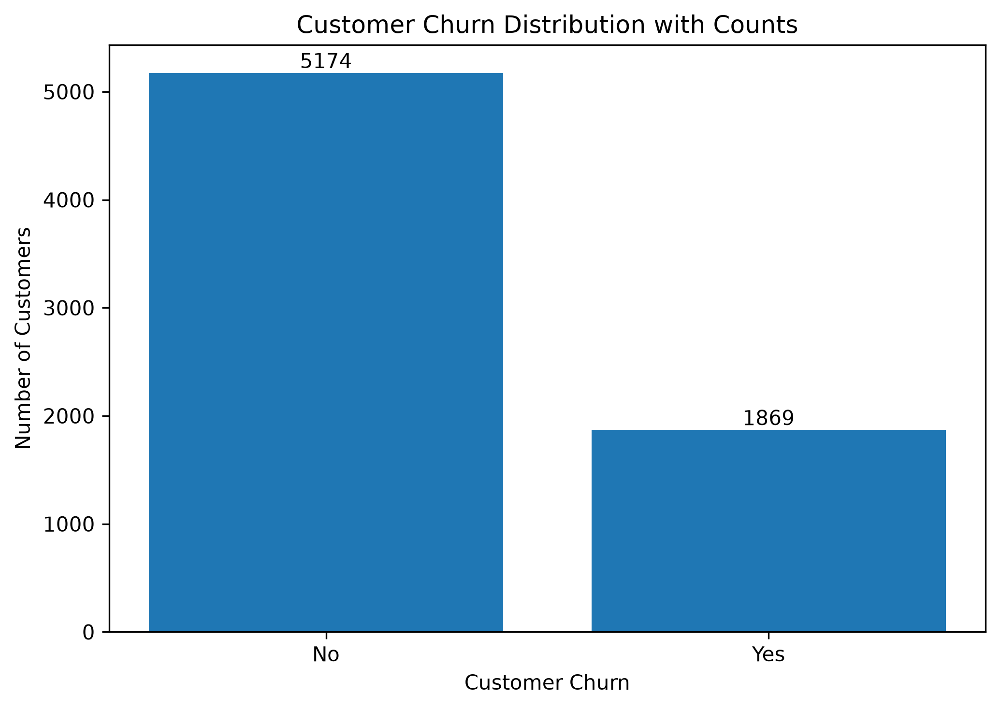
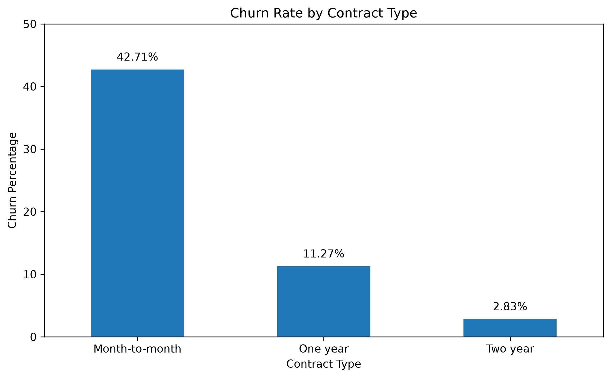
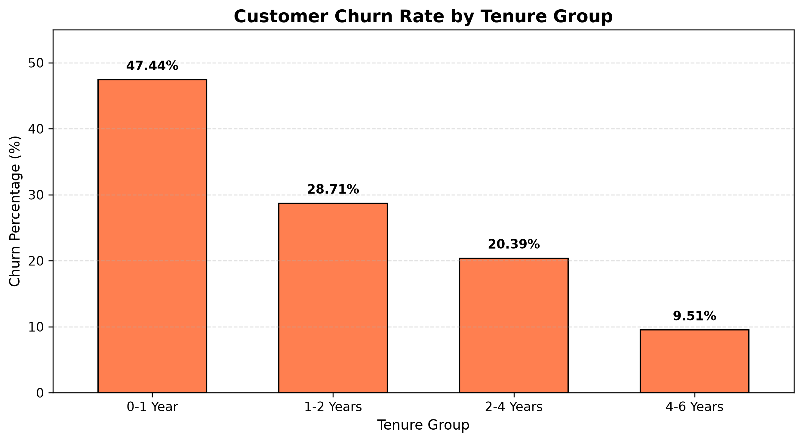
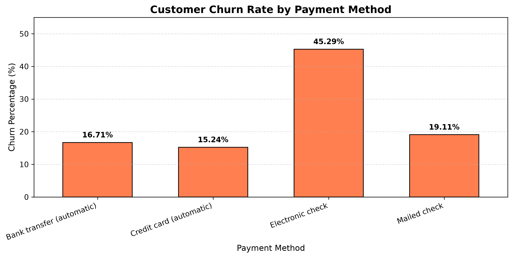
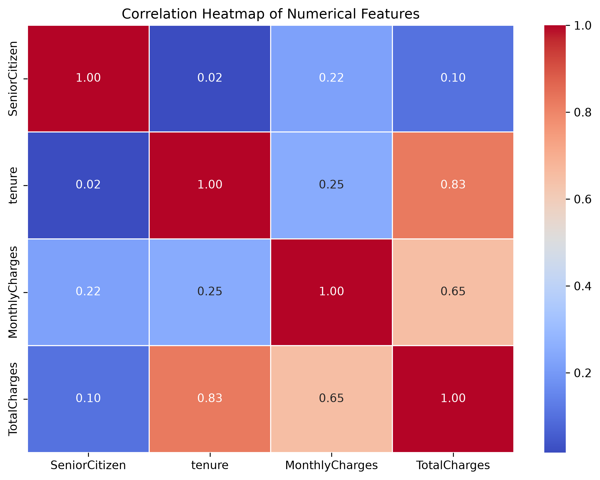

# Customer Churn Prediction

## Project Overview

This project uses machine learning to predict whether a customer is likely to leave a telecommunications service provider.

The objective is to analyze customer information, identify patterns associated with churn, and build classification models that can help businesses identify customers who may be at risk of leaving.

## Problem Statement

Customer churn is an important challenge for subscription-based businesses. Losing existing customers can affect revenue and business growth.

This project explores customer data and develops machine learning models to predict customer churn.

## Dataset

- **Dataset:** IBM Telco Customer Churn
- **Records:** 7,043 customers
- **Features:** 20 input features and 1 target variable
- **Target variable:** Churn (Yes/No)

The dataset contains customer demographics, subscription details, services used, payment methods, and billing information.

## Technologies Used

- Python
- Pandas
- NumPy
- Matplotlib
- Seaborn
- Scikit-learn
- Joblib
- Git and GitHub

## Project Workflow

1. **Data Exploration:** Examined the dataset, feature distributions, customer characteristics, and churn patterns.
2. **Data Cleaning:** Handled missing values in the `TotalCharges` column.
3. **Data Preprocessing:** Separated features and target, encoded categorical variables, and scaled numerical features.
4. **Model Development:** Trained and evaluated multiple classification algorithms.
5. **Model Evaluation:** Compared model performance using accuracy, precision, recall, F1-score, and ROC-AUC.
6. **Model Selection:** Selected Balanced Logistic Regression based on its ability to identify a higher proportion of actual churn customers.

## Exploratory Data Analysis

### 1. Customer Churn Distribution



### 2. Churn by Contract Type



### 3. Churn by Tenure



### 4. Churn by Payment Method



### 5. Correlation Heatmap



## Machine Learning Models

The following classification models were implemented:

- Logistic Regression
- Decision Tree Classifier
- Random Forest Classifier
- Balanced Logistic Regression

## Model Performance

| Model | Accuracy | Precision | Recall | F1-Score | ROC-AUC |
|---|---:|---:|---:|---:|---:|
| Logistic Regression | 80.6% | 65.7% | 55.9% | 60.4% | 84.2% |
| Decision Tree | 72.1% | 47.5% | 49.2% | 48.4% | 64.8% |
| Random Forest | 78.6% | 62.5% | 48.7% | 54.7% | 81.9% |
| Balanced Logistic Regression | 73.8% | 50.4% | 78.3% | 61.4% | 84.2% |

## Selected Model

**Balanced Logistic Regression**

The balanced model achieved the highest churn recall of approximately 78.3% and the highest F1-score of approximately 61.4%.

It was selected because identifying more potential churn customers was prioritized over maximizing overall accuracy.

The model produces more false positives than the standard Logistic Regression model, so the final choice depends on the business cost of unnecessary customer-retention interventions.

## Project Structure

```text
Customer_Churn_Prediction/
│
├── data/
│   ├── raw/
│   └── processed/
│
├── notebooks/
│   ├── 01_data_exploration.py
│   ├── 02_data_preprocessing.py
│   └── 03_model_training.py
│
├── models/
│   └── balanced_logistic_model.pkl
│
├── reports/
│   └── model_comparison.csv
│
├── .gitignore
├── requirements.txt
└── README.md
```

## How to Run the Project

### 1. Clone the repository

```bash
git clone <your-github-repository-url>
cd Customer_Churn_Prediction
```

### 2. Create a virtual environment

```bash
python -m venv .venv
```

### 3. Activate the environment

Windows PowerShell:

```powershell
.venv\Scripts\Activate.ps1
```

### 4. Install dependencies

```bash
pip install -r requirements.txt
```

### 5. Download the dataset

Download the IBM Telco Customer Churn CSV dataset and place it at:

```text
data/raw/Telco-Customer-Churn.csv
```

### 6. Run the scripts

```bash
python notebooks/01_data_exploration.py
python notebooks/02_data_preprocessing.py
python notebooks/03_model_training.py
```

The preprocessing script generates the processed datasets, and the model training script trains, evaluates, and saves the selected model.

## Key Learnings

- Exploratory Data Analysis and data cleaning
- Handling missing values
- Categorical feature encoding
- Feature scaling and prevention of data leakage
- Training and evaluating classification models
- Understanding precision, recall, F1-score, and ROC-AUC
- Comparing models and selecting one based on business objectives
- Saving and loading trained machine learning models

## Conclusion

This project demonstrates an end-to-end customer churn classification workflow, from data exploration and preprocessing to model development and evaluation.

The results highlight the importance of selecting machine learning models based not only on overall accuracy but also on the business objective and the cost of prediction errors.
